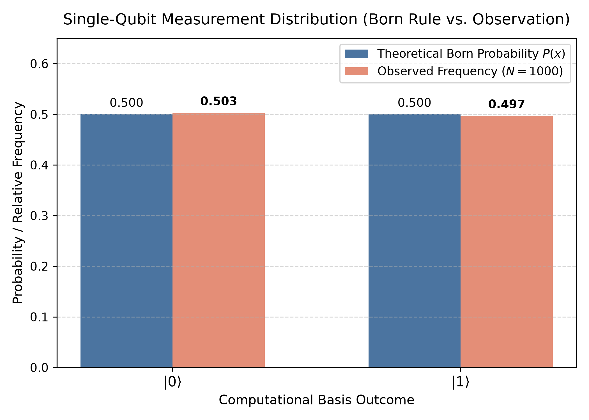
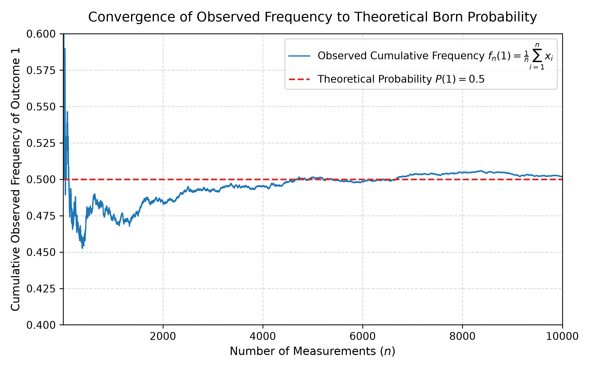
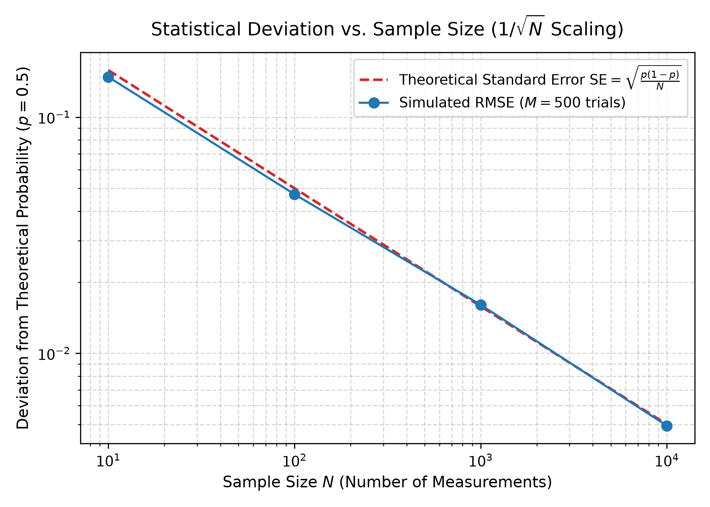

# Quantum Measurement: Probability vs. Observation

A minimal, rigorous Python simulation of single-qubit quantum measurement statistics, investigating the relationship between theoretical Born-rule probabilities and finite empirical observation.

---

## 1. Motivation

In quantum mechanics, the state vector $|\psi\rangle$ provides complete description of an isolated quantum system, yet individual projective measurements yield discrete, probabilistic outcomes. For an undergraduate physics student transitioning into quantum computing and quantum information, understanding the bridge between state amplitudes, Born probabilities, and finite-sample fluctuations is fundamental.

This project implements a reproducible numerical simulation from first principles using Python and NumPy to explore how observed frequencies fluctuate around theoretical predictions and how empirical uncertainty scales with sample size.

---

## 2. Research Question

> **How do repeated measurements of an ideal single-qubit quantum system fluctuate statistically across finite experiments, and how do observed frequencies converge toward the probabilities predicted by the Born rule?**

---

## 3. Scope & Scientific Boundaries

### What This Project Demonstrates
- Pure single-qubit state representation via normalized complex amplitudes $\alpha, \beta \in \mathbb{C}$.
- Strict rejection of unnormalized states without silent normalization.
- Theoretical probability calculation via the Born rule: $P(0) = |\alpha|^2$ and $P(1) = |\beta|^2$.
- Computational-basis measurement sampling using isolated, reproducible pseudo-random generation.
- Empirical statistical fluctuations across finite measurement counts ($N$).
- Convergence of cumulative sample frequencies toward theoretical expectation (Weak Law of Large Numbers).
- Empirical scaling of root-mean-square error ($\mathrm{RMSE}$) matching the theoretical standard error $\mathrm{SE} = \sqrt{p(1-p)/N}$ ($N^{-1/2}$ scaling).

### What This Project Does Not Demonstrate
- **Not physical quantum hardware:** This is a classical numerical simulation of idealized quantum measurement statistics, not an interface to real quantum processors or physical detectors.
- **Not experimental proof of quantum theory:** Classical coin tosses or Bernoulli trials follow the exact same binomial statistics. Randomness alone does not prove a system is quantum mechanical.
- **No state collapse dynamics or environmental decoherence:** Assumes instantaneous, projective, ideal measurements on identically prepared independent states without noise.
- **No universal quantum gates, circuits, or algorithms:** Focus is strictly confined to measurement statistics of a single pure qubit.

---

## 4. Mathematical Model

### Single-Qubit Pure State
A pure single-qubit state is represented in the computational basis $\{|0\rangle, |1\rangle\}$ as:

$$|\psi\rangle = \alpha |0\rangle + \beta |1\rangle, \quad \alpha, \beta \in \mathbb{C}$$

Physical state validity requires normalization to unity:

$$\langle \psi | \psi \rangle = |\alpha|^2 + |\beta|^2 = 1$$

In this implementation, states failing $||\alpha|^2 + |\beta|^2 - 1| \le 10^{-9}$ are strictly rejected.

### The Born Rule
According to the Born rule, projective measurement in the computational basis produces outcome $0$ or $1$ with probabilities:

$$P(0) = |\langle 0 | \psi \rangle|^2 = |\alpha|^2$$

$$P(1) = |\langle 1 | \psi \rangle|^2 = |\beta|^2$$

When $|\psi\rangle$ is a computational-basis eigenstate ($|0\rangle$ or $|1\rangle$), the outcome is deterministic ($P=1$), producing identical results across all measurements. For superpositions (e.g., $(|0\rangle + |1\rangle)/\sqrt{2}$), outcomes are genuinely probabilistic.

### Finite Measurement Statistics
For $N$ independent, identically prepared trials:
- The total count of outcome $1$, denoted $K$, follows a binomial distribution:
  $$K \sim \mathrm{Binomial}(N, p), \quad \text{where } p = P(1)$$
- The observed sample frequency is:
  $$\hat{p}_N = \frac{K}{N}$$
- The theoretical expectation is $\mathbb{E}[\hat{p}_N] = p$.
- The theoretical standard error of the observed frequency is:
  $$\mathrm{SE} = \sqrt{\frac{\mathrm{Var}(\hat{p}_N)}{N}} = \sqrt{\frac{p(1-p)}{N}}$$
- For deterministic states ($p = 0$ or $p = 1$), $\mathrm{SE} = 0$.

---

## 5. Experimental Methodology & Results

The simulation executes three deterministic numerical experiments using [`experiments/run_experiments.py`](experiments/run_experiments.py).

### Experiment A: Measurement Distribution ($N = 1{,}000$)

A balanced superposition state is prepared:

$$|\psi\rangle = \frac{1}{\sqrt{2}}|0\rangle + \frac{1}{\sqrt{2}}|1\rangle \implies P(0) = 0.5, \quad P(1) = 0.5$$

A series of $N = 1{,}000$ independent shots were simulated with a fixed random seed (`seed=42`).

| Outcome | Simulated Count | Observed Frequency | Theoretical $P(x)$ | Absolute Deviation |
| :---: | :---: | :---: | :---: | :---: |
| $|0\rangle$ | 503 | 0.5030 | 0.5000 | 0.0030 |
| $|1\rangle$ | 497 | 0.4970 | 0.5000 | 0.0030 |



**Discussion:** The observed frequencies ($0.503$ and $0.497$) show close agreement with the theoretical probabilities ($0.500$). The deviation of $0.0030$ is well within the expected theoretical standard error for $N=1{,}000$ shots ($\mathrm{SE} = \sqrt{0.25 / 1000} \approx 0.0158$).

---

### Experiment B: Cumulative-Frequency Convergence ($N = 10{,}000$)

Simulating a sequential stream of $N = 10{,}000$ shots on the balanced state, the running cumulative frequency of outcome 1 is tracked:

$$f_n(1) = \frac{1}{n} \sum_{i=1}^n x_i, \quad n \in [1, 10000]$$



**Discussion:** 
- In the low-sample regime ($n < 500$), the observed frequency exhibits significant fluctuations (ranging between $\approx 0.45$ and $0.59$).
- As $n$ increases, the magnitude of fluctuations dampens, asymptotically centering near the theoretical line $P(1) = 0.5$.
- Crucially, convergence is **non-monotonic**: the curve oscillates above and below $0.5$ rather than smoothly approaching it, illustrating the probabilistic nature of random sampling under the Law of Large Numbers. At $n = 10{,}000$, the final observed frequency is $0.5019$ (deviation $0.0019$).

---

### Experiment C: Statistical Deviation Scaling ($1/\sqrt{N}$)

To rigorously test how sample size influences empirical precision, simulations were performed across four orders of magnitude: $N \in \{10, 100, 1{,}000, 10{,}000\}$. For each sample size, $M = 500$ independent simulated experiments were run.

The empirical root-mean-square error ($\mathrm{RMSE}$) was calculated:

$$\mathrm{RMSE} = \sqrt{\frac{1}{M} \sum_{m=1}^M \left( \hat{p}_{m, N} - p \right)^2}$$

and compared against the theoretical standard error $\mathrm{SE} = \sqrt{\frac{p(1-p)}{N}}$.

| Sample Size ($N$) | Theoretical $\mathrm{SE}$ | Simulated $\mathrm{RMSE}$ ($M=500$) | Ratio ($\mathrm{RMSE}/\mathrm{SE}$) |
| :---: | :---: | :---: | :---: |
| 10 | 0.15811 | 0.14799 | 0.9359 |
| 100 | 0.05000 | 0.04714 | 0.9429 |
| 1,000 | 0.01581 | 0.01604 | 1.0147 |
| 10,000 | 0.00500 | 0.00494 | 0.9871 |



**Discussion:**
- On a log-log scale, both the theoretical standard error and the empirical $\mathrm{RMSE}$ follow a linear trend with slope $-1/2$.
- Each order-of-magnitude ($10\times$) increase in measurement count reduces the expected deviation by a factor of $\sqrt{10} \approx 3.16$.
- This verifies that while an individual finite sample can deviate by chance, the ensemble uncertainty strictly obeys the standard statistical scaling $\mathcal{O}(1/\sqrt{N})$.

---

## 6. Repository Structure

```text
quantum-measurement/
├── prompt.md                    # Project specification and progress tracking
├── README.md                    # Scientific review, results, and usage guide
├── requirements.txt             # Minimal third-party dependencies
├── src/
│   ├── __init__.py              # Package initialization and public API
│   ├── quantum_state.py         # Pure single-qubit representation and validation
│   ├── measurement.py           # Computational-basis sampling using Born rule
│   └── statistics.py            # Counts, frequencies, deviations, and standard error
├── experiments/
│   └── run_experiments.py       # Deterministic CLI runner for Experiments A, B, and C
├── results/
│   ├── measurement_distribution.png
│   ├── convergence.png
│   └── statistical_deviation.png
└── tests/
    └── test_quantum_state.py    # 15 automated unit tests (unittest)
```

---

## 7. Setup & Reproducibility Guide

### Prerequisites
- Python 3.9+ (tested on Python 3.13.7)
- Standard library modules (`math`, `unittest`, `pathlib`, `typing`)

### Environment Setup
To ensure reproducibility in an isolated environment:

```bash
# 1. Clone or navigate to the repository root
cd quantum-measurement

# 2. Create a virtual environment
python3 -m venv .venv

# 3. Activate the virtual environment
# On Linux / macOS:
source .venv/bin/activate
# On Windows:
# .venv\Scripts\activate

# 4. Install the minimal dependencies
pip install --upgrade pip
pip install -r requirements.txt
```

### Running the Experiments
To execute Experiments A, B, and C and regenerate the plots in `results/`:

```bash
python experiments/run_experiments.py
```

### Running the Automated Tests
To run the full unit test suite with verbose output:

```bash
python -m unittest discover -s tests -v
```

---

## 8. Assumptions & Limitations

1. **State Purity:** Considers only pure states represented by single state vectors $|\psi\rangle$, not mixed states described by density matrices $\rho$.
2. **Measurement Model:** Assumes projective von Neumann measurements in the computational basis $\{|0\rangle, |1\rangle\}$. Generalized measurements (POVMs) or measurements in other bases ($X$ or $Y$) are outside the scope.
3. **No Hardware Noise:** Assumes ideal state preparation and error-free measurement without detector inefficiency, readout crosstalk, or environmental decoherence.
4. **Pseudo-Randomness:** Measurements are sampled using NumPy's PCG64 pseudo-random number generator (`np.random.default_rng`), not true physical quantum randomness.

---

## 9. Conclusion

This project numerically validates the relationship between Born-rule probabilities and empirical observation. By systematically comparing theoretical predictions against finite simulated measurements, it demonstrates how individual probabilistic outcomes accumulate into deterministic statistical ensembles, governed by the $1/\sqrt{N}$ scaling of the standard error.
